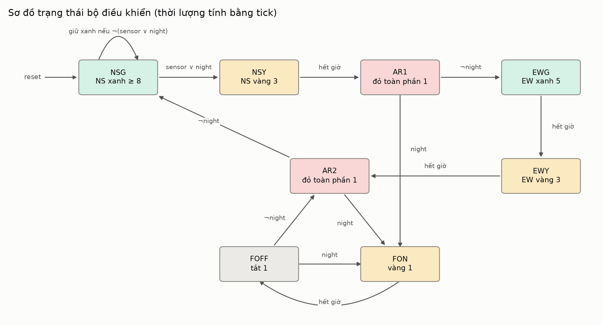
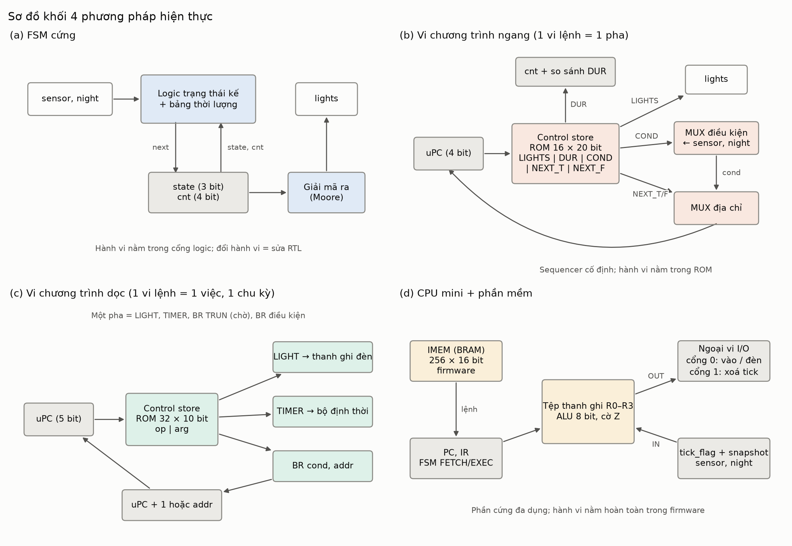
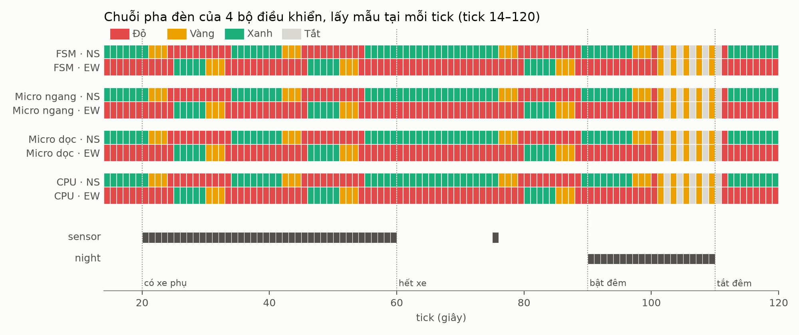
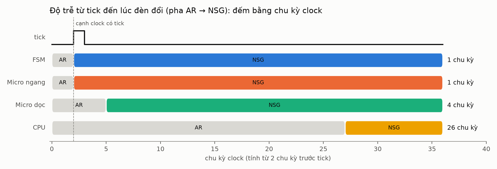
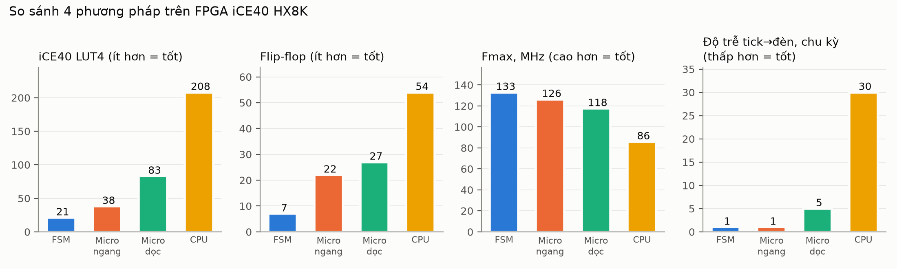
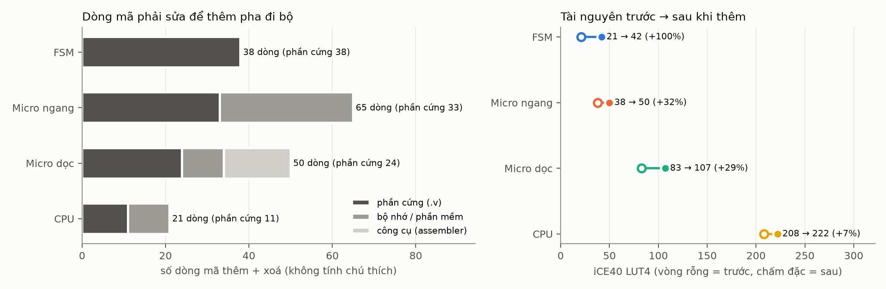

# Thiết kế và so sánh các phương pháp hiện thực bộ điều khiển đèn giao thông trên Verilog: FSM cứng, vi chương trình và CPU mini

Bản Markdown sinh tự động từ báo cáo LaTeX bằng `scripts/tex2md.py`; bản chính để nộp là PDF biên dịch từ thư mục mẫu HUST.

## Tóm tắt

Báo cáo so sánh ba cách tổ chức khối điều khiển trong kiến trúc máy tính: điều khiển cứng, điều khiển vi chương trình, và CPU chạy phần mềm. Bài toán dùng để so sánh là bộ điều khiển đèn giao thông cho một ngã tư có cảm biến xe ở đường phụ và chế độ nhấp nháy ban đêm. Cùng một đặc tả được viết bằng Verilog theo bốn cách: FSM cứng, vi chương trình ngang, vi chương trình dọc, và một CPU 8 bit 16 lệnh đa chu kỳ chạy firmware hợp ngữ. Assembler và micro-assembler được viết bằng Python.

Trên Icarus Verilog, bốn bản cho ra cùng một chuỗi đèn trong 360 tick mô phỏng, không có vi phạm an toàn. Tập lệnh CPU được thử riêng với đủ 16 opcode, và các testbench bắt được cả 9 lỗi cài vào. Các thiết kế được tổng hợp và đặt-đi dây cho FPGA Lattice iCE40 bằng Yosys và nextpnr để đo tài nguyên, tần số tối đa và độ trễ. Chi phí sửa đổi được đo qua hai thí nghiệm: đổi một tham số và thêm pha cho người đi bộ.

FSM cứng nhỏ nhất (21 LUT) và nhanh nhất. CPU mini cần khoảng 10 lần tài nguyên và phản ứng chậm hơn (tối đa 30 chu kỳ clock), nhưng thêm pha đi bộ không phải sửa lõi CPU, và firmware vá được thẳng vào bitstream. Vi chương trình ngang gọn (38 LUT) nhưng khó mở rộng nhất khi yêu cầu mới vượt khỏi định dạng vi lệnh; vi chương trình dọc ở quy mô này lại tốn nhiều LUT hơn bản ngang. Qua đề tài, em đã làm quen với thiết kế RTL, thiết kế tập lệnh, viết công cụ hợp dịch, kiểm chứng bằng mô phỏng và quy trình FPGA mã nguồn mở.

## Chương 1. Tổng quan đề tài

Chương này nêu vấn đề đề tài giải quyết, mục tiêu, phạm vi, công cụ đã dùng và bố cục của báo cáo.

### Đặt vấn đề
Một bộ xử lý gồm đường dữ liệu (datapath) thực hiện phép tính và khối điều khiển (control unit) sinh tín hiệu điều khiển đường dữ liệu theo đúng trình tự. Giáo trình kiến trúc máy tính [1, 2] trình bày hai cách xây khối điều khiển. Cách thứ nhất là **điều khiển cứng** (hardwired control): tín hiệu điều khiển là đầu ra của một máy trạng thái hữu hạn (FSM) làm bằng cổng logic. Cách thứ hai là **điều khiển vi chương trình** (microprogrammed control), do M. V. Wilkes đề xuất năm 1951 [3]: tín hiệu điều khiển được đọc ra từ một bộ nhớ điều khiển (control store). Trong hệ nhúng còn có cách thứ ba là dùng một CPU đa dụng chạy phần mềm.

Giáo trình so sánh các cách này bằng lời: điều khiển cứng nhanh nhưng khó sửa, vi chương trình dễ sửa nhưng chậm hơn. Đề tài muốn đo các nhận định đó bằng số. Bài toán được chọn là bộ điều khiển đèn giao thông cho một ngã tư. Nó đủ nhỏ để làm trọn trong một học kỳ, nhưng vẫn có rẽ nhánh theo cảm biến, đếm thời gian và hai chế độ chạy ngày, đêm.

### Mục tiêu
Đề tài có bốn mục tiêu:
- Viết bằng Verilog [4] bốn bản của cùng một bộ điều khiển: FSM cứng, vi chương trình ngang, vi chương trình dọc và CPU 8 bit chạy firmware.
- Chứng minh bằng mô phỏng rằng bốn bản cho ra cùng một chuỗi đèn, kiểm tra riêng tập lệnh CPU, và kiểm tra chính các testbench bằng cách cài lỗi.
- Đo tài nguyên FPGA, tần số tối đa, độ trễ phản ứng, và số dòng mã phải sửa khi đổi yêu cầu.
- Giải thích các con số đo được bằng kiến thức của học phần.

### Phạm vi
Ngã tư có hai hướng, một cảm biến xe ở đường phụ và chế độ nhấp nháy vàng ban đêm; thí nghiệm mở rộng thêm pha cho người đi bộ. Mọi số liệu lấy từ mô phỏng và từ tổng hợp, đặt-đi dây cho FPGA Lattice iCE40 HX8K [5]. File nạp cho hai kit Basys 3 và DE10-Lite đã có trong mã nguồn nhưng chưa được chạy trên mạch thật. Báo cáo không đo công suất (bộ công cụ mã nguồn mở cho iCE40 không có mô hình công suất).

### Công cụ sử dụng
Mô phỏng dùng Icarus Verilog 12 [6], xem dạng sóng bằng GTKWave. Tổng hợp logic, đặt-đi dây và phân tích thời gian dùng Yosys 0.69 và nextpnr-ice40 [7]; đóng gói bitstream và thay nội dung block RAM dùng các công cụ của Project IceStorm [8]. Assembler, micro-assembler, script đo đạc và script vẽ hình được viết bằng Python 3 với thư viện matplotlib.

### Bố cục báo cáo
Chương 2 tóm tắt lý thuyết về khối điều khiển cứng, vi chương trình và CPU đa chu kỳ. Chương 3 nêu đặc tả bài toán và thiết kế bốn bộ điều khiển. Chương 4 trình bày cách kiểm chứng và kết quả mô phỏng. Chương 5 so sánh bốn bản bằng số liệu đo. Mã nguồn chính nằm ở Phụ lục.

## Chương 2. Cơ sở lý thuyết

Chương này tóm tắt bốn mảng kiến thức mà các chương sau dùng tới: máy trạng thái và khối điều khiển cứng, khối điều khiển vi chương trình với hai kiểu vi lệnh ngang và dọc, CPU đa chu kỳ có giao tiếp vào/ra, và cấu trúc FPGA cùng quy trình tổng hợp.

### Máy trạng thái hữu hạn và khối điều khiển cứng
Một máy trạng thái hữu hạn (FSM) có ba phần [9]: thanh ghi trạng thái, logic tính trạng thái kế tiếp từ trạng thái hiện tại và đầu vào, và logic đầu ra. Ở máy Moore, đầu ra chỉ phụ thuộc trạng thái; ở máy Mealy, đầu ra phụ thuộc cả đầu vào.

Khối điều khiển cứng là một FSM có đầu ra là các tín hiệu điều khiển. Toàn bộ hàm điều khiển là logic tổ hợp, nên công cụ tổng hợp tối ưu được nó đến từng cổng; kết quả thường nhỏ và nhanh. Đổi lại, muốn đổi hành vi thì phải thiết kế lại mạch. Patterson và Hennessy dùng cách này cho bộ xử lý RISC-V trong giáo trình của họ [2].

### Khối điều khiển vi chương trình
Theo đề xuất của Wilkes [3], mỗi bước điều khiển được ghi thành một vi lệnh (microinstruction) trong bộ nhớ điều khiển. Phần cứng còn lại là bộ sắp xếp vi lệnh (micro-sequencer): một thanh ghi địa chỉ vi lệnh uPC, logic chọn địa chỉ kế tiếp (tăng tuần tự, nhảy hoặc rẽ nhánh theo điều kiện), và thường có thêm thanh ghi vi lệnh MIR giữ vi lệnh đang chạy [1]. Đổi hành vi chỉ cần đổi nội dung bộ nhớ điều khiển.

Stallings [1] phân biệt hai kiểu mã hoá vi lệnh. Ở **vi lệnh ngang** (horizontal), mỗi bit hoặc mỗi trường điều khiển trực tiếp một phần phần cứng và không cần giải mã; một vi lệnh làm được nhiều việc cùng lúc, nên vi chương trình ngắn nhưng từ vi lệnh rộng và có nhiều trường bỏ trống. Ở vi lệnh dọc (vertical), vi lệnh được mã hoá giống lệnh máy, gồm opcode và toán hạng. Mỗi vi lệnh chỉ làm một việc và cần bộ giải mã; từ vi lệnh hẹp hơn nhưng vi chương trình dài hơn.

Các máy CISC như IBM System/360 và VAX dùng vi chương trình vì tập lệnh của chúng lớn. CPU x86 hiện nay dùng cả hai cách: lệnh đơn giản được giải mã cứng, lệnh phức tạp chạy bằng vi mã, và vi mã có thể nạp bản cập nhật để vá lỗi.

### CPU đa chu kỳ và giao tiếp vào/ra
Kiến trúc tập lệnh (ISA) quy định những gì phần mềm nhìn thấy: các lệnh, định dạng lệnh, thanh ghi và cách truy cập bộ nhớ, thiết bị vào/ra. Trong vi kiến trúc đa chu kỳ [2, 9], mỗi lệnh chạy qua nhiều bước như nạp lệnh, giải mã, thực thi; mỗi bước tốn một chu kỳ clock. Số chu kỳ trung bình cho một lệnh gọi là CPI. Khối điều khiển của CPU đa chu kỳ lại chính là một FSM, nghĩa là điều khiển cứng vẫn có mặt ở tầng dưới.

CPU nói chuyện với thiết bị ngoại vi qua không gian địa chỉ vào/ra riêng (lệnh `IN`, `OUT`) hoặc qua vào/ra ánh xạ bộ nhớ. Có hai cách để CPU biết một sự kiện bên ngoài đã xảy ra. Hỏi vòng (polling) là để phần mềm đọc đi đọc lại một cờ trạng thái; ngắt (interrupt) là để phần cứng chủ động báo cho CPU. Khi dùng hỏi vòng mà sự kiện chỉ dài một chu kỳ clock, ngoại vi phải chốt nó vào một cờ. Nếu không, phần mềm sẽ bỏ lỡ.

### FPGA và quy trình tổng hợp
Mỗi logic cell của FPGA iCE40 [5] có một bảng tra 4 đầu vào (LUT4), một flip-flop và logic tạo số nhớ `SB_CARRY` cho bộ cộng. Chip còn có các block RAM 4 Kbit (`SB_RAM40_4K`) đọc đồng bộ.

Quy trình mã nguồn mở cho iCE40 [7, 8] đi qua bốn công cụ. Yosys tổng hợp RTL thành mạng LUT, flip-flop và BRAM. nextpnr đặt-đi dây và phân tích thời gian để ra tần số tối đa Fmax. icepack đóng gói kết quả thành bitstream, còn icebram thay nội dung BRAM trong bitstream có sẵn mà không phải đặt-đi dây lại. Ở bước tổng hợp, ROM chỉ được đặt vào BRAM khi cổng đọc của nó là đồng bộ; ROM đọc bất đồng bộ bị chuyển thành LUT.

### Kết luận chương
Đi từ điều khiển cứng qua vi chương trình tới CPU, phần mô tả hành vi chuyển dần từ cổng logic sang nội dung bộ nhớ. Hệ quả của sự chuyển dịch này lên diện tích, tốc độ và khả năng sửa đổi mới chỉ là định tính trong giáo trình; Chương 5 đo nó bằng số trên cùng một bài toán.

## Chương 3. Đặc tả và thiết kế bốn bộ điều khiển

Chương này nêu đặc tả chung của bộ điều khiển đèn giao thông, rồi thiết kế lần lượt bốn bản: FSM cứng, vi chương trình ngang, vi chương trình dọc và CPU mini chạy firmware. Cả bốn bản có cùng một giao diện, nên có thể thay thế cho nhau trong cùng một testbench và trên cùng một kit FPGA.

### Đặc tả bài toán
Đặc tả gồm giao diện tín hiệu, tám pha đèn với thời lượng của chúng, và một số quy tắc an toàn. Ba phần này dùng chung cho cả bốn bản thiết kế.

#### Giao diện
Ngã tư gồm đường chính Bắc–Nam (NS) và đường phụ Đông–Tây (EW); mỗi hướng có ba đèn đỏ, vàng, xanh. Giao diện chung được cho ở Bảng 3.1.

*Bảng 3.1. Giao diện chung của bộ điều khiển*

| Tín hiệu | Hướng | Bit | Ý nghĩa |
| --- | --- | --- | --- |
| `clk` | vào | 1 | Clock hệ thống (50 MHz trên kit, 100 MHz khi mô phỏng) |
| `rst` | vào | 1 | Reset đồng bộ, mức cao |
| `tick` | vào | 1 | Xung rộng 1 chu kỳ clock, mỗi giây một lần (đơn vị thời gian) |
| `night` | vào | 1 | Chế độ đêm: hai hướng cùng nhấp nháy vàng |
| `sensor` | vào | 1 | Có xe đang chờ ở đường phụ EW |
| `lights` | ra | 6 | `{ns_r, ns_y, ns_g, ew_r, ew_y, ew_g}` |

#### Các pha và thời lượng
Bộ điều khiển có tám pha (Bảng 3.2); Hình 3.1 là sơ đồ trạng thái tương ứng.

*Bảng 3.2. Các pha đèn, thời lượng và điều kiện chuyển pha*

| Pha | NS | EW | `lights` | Tick | Pha kế tiếp |
| --- | --- | --- | --- | --- | --- |
| NSG | Xanh | Đỏ | `001_100` | ≥8 | NSY khi sensor∨night; ngược lại giữ xanh |
| NSY | Vàng | Đỏ | `010_100` | 3 | AR1 |
| AR1 | Đỏ | Đỏ | `100_100` | 1 | FON nếu night, ngược lại EWG |
| EWG | Đỏ | Xanh | `100_001` | 5 | EWY |
| EWY | Đỏ | Vàng | `100_010` | 3 | AR2 |
| AR2 | Đỏ | Đỏ | `100_100` | 1 | FON nếu night, ngược lại NSG |
| FON | Vàng | Vàng | `010_010` | 1 | FOFF |
| FOFF | Tắt | Tắt | `000_000` | 1 | FON nếu night, ngược lại AR2 |



*Hình 3.1. Sơ đồ trạng thái của bộ điều khiển (thời lượng tính bằng tick)*

Giữa hai pha xanh luôn có một tick **đỏ toàn phần** (pha AR) để xe trong giao lộ kịp ra hết. Bộ điều khiển chỉ vào hoặc ra chế độ đêm tại pha AR, không bao giờ cắt ngang pha xanh. Đường chính được ưu tiên: sau tối thiểu 8 tick, nếu đường phụ không có xe thì NS giữ xanh.

Thời gian trong đặc tả được tính theo tick. Mọi đầu vào được lấy mẫu tại cạnh clock có `tick = 1`, và một pha dài D tick nghĩa là đèn của pha đó được quan sát ở đúng D lần lấy mẫu liên tiếp. Bốn bản thiết kế phản ứng sau tick với độ trễ từ 1 đến 30 chu kỳ clock (đo ở Chương 4); đo theo tick thì cả bốn được so trên cùng một chuẩn.

Hình 3.2 vẽ sơ đồ khối của bốn bản. Các mục tiếp theo mô tả từng bản.



*Hình 3.2. Sơ đồ khối bốn phương pháp hiện thực*

### Phương pháp 1: FSM cứng
Bản FSM cứng (`rtl/tlc_fsm.v`) là máy Moore 8 trạng thái, mã nhị phân 3 bit, cộng một bộ đếm tick 4 bit. Trạng thái kế tiếp, thời lượng pha và tín hiệu đèn đều là các khối `case` tổ hợp:

```
always @* begin
    case (state)
        S_NSG: begin dur = `T_NSG; next = (sensor | night) ? S_NSY : S_NSG; end
        S_NSY: begin dur = `T_Y;   next = S_AR1;                            end
        S_AR1: begin dur = `T_AR;  next = night ? S_FON : S_EWG;            end
        ...
    endcase
end
wire expired = (cnt >= dur - 4'd1);
always @(posedge clk)
    if (rst) begin state <= S_NSG; cnt <= 0; end
    else if (tick) begin
        if (!expired)            cnt <= cnt + 4'd1;
        else if (next != state)  begin state <= next; cnt <= 0; end
        // hết giờ và next == state: giữ nguyên (NS xanh chờ xe)
    end
```

Thứ tự các pha nằm trong các khối `case` này. Đổi thứ tự hay thêm pha đều phải sửa RTL rồi tổng hợp lại.

### Phương pháp 2a: Vi chương trình ngang
Phần cứng của bản vi chương trình ngang (`rtl/tlc_micro.v`) gồm thanh ghi `uPC` 4 bit, bộ đếm tick, một MUX chọn điều kiện và một MUX chọn địa chỉ kế tiếp. Thứ tự pha nằm trong ROM 16×20 bit (`rtl/microcode.mem`). Mỗi vi lệnh ứng với một pha; các trường của nó điều khiển phần cứng cùng lúc, và mỗi vi lệnh mang sẵn hai địa chỉ kế tiếp theo cách tổ chức của Wilkes [3]. Bảng 3.3 là định dạng vi lệnh, Bảng 3.4 là nội dung bộ nhớ điều khiển.

*Bảng 3.3. Định dạng vi lệnh ngang (20 bit)*

| Bit | Trường | Ý nghĩa |
| --- | --- | --- |
| 19:14 | LIGHTS | Tổ hợp đèn xuất ra |
| 13:10 | DUR | Thời lượng tối thiểu (tick) |
| 9:8 | COND | `00` luôn đúng, `01` night, `10` sensor∨night, `11` sensor |
| 7:4 | NEXT_T | Địa chỉ kế tiếp khi điều kiện đúng |
| 3:0 | NEXT_F | Địa chỉ kế tiếp khi điều kiện sai (bằng uPC hiện tại thì đứng chờ) |

*Bảng 3.4. Nội dung bộ nhớ điều khiển của vi chương trình ngang*

| Địa chỉ | Nhãn | LIGHTS | DUR | COND | NEXT_T | NEXT_F |
| --- | --- | --- | --- | --- | --- | --- |
| 0 | NSG | `001100` | 8 | sensor∨night | 1 | 0 |
| 1 | NSY | `010100` | 3 | luôn đúng | 2 | 2 |
| 2 | AR1 | `100100` | 1 | night | 6 | 3 |
| 3 | EWG | `100001` | 5 | luôn đúng | 4 | 4 |
| 4 | EWY | `100010` | 3 | luôn đúng | 5 | 5 |
| 5 | AR2 | `100100` | 1 | night | 6 | 0 |
| 6 | FON | `010010` | 1 | luôn đúng | 7 | 7 |
| 7 | FOFF | `000000` | 1 | night | 6 | 5 |
| 8–15 | (trống) | `100100` | 1 | luôn đúng | 0 | 0 |

Tám ô 8–15 chưa dùng được điền “đỏ toàn phần rồi về NSG”. Nếu `uPC` vì lý do nào đó nhảy vào vùng này, đèn vẫn đỏ cả hai hướng rồi quay về pha đầu.

### Phương pháp 2b: Vi chương trình dọc
Để có số liệu so sánh hai kiểu vi lệnh, đề tài làm thêm bản dọc trong file `rtl/tlc_vmicro.v`. Mỗi vi lệnh dài 10 bit, mã hoá theo opcode, chỉ làm một việc và chạy trong một chu kỳ clock (Bảng 3.5).

*Bảng 3.5. Tập vi lệnh dọc (10 bit: 2 bit op, 8 bit tham số)*

| op | Vi lệnh | Thao tác |
| --- | --- | --- |
| 00 | `LIGHT x` | thanh ghi đèn ← x |
| 01 | `TIMER d` | bộ định thời ← d (giảm 1 ở mỗi tick) |
| 10 | `BR cond, addr` | nếu `cond` thì uPC ← addr, ngược lại uPC ← uPC + 1 |
| 11 | `CLR m` | xoá cờ yêu cầu (để dành cho mở rộng) |

Lệnh `BR` có 8 mã điều kiện: `ALWAYS`, `TRUN` (bộ định thời còn chạy), `NIGHT`, `NNIGHT`, `SN`, `NSN`, `SENSOR`, `NSENSOR`. Mỗi pha cần 3 hoặc 4 vi lệnh; với pha NSG là:

```
nsg:    LIGHT L_NSG
        TIMER T_NSG
nsg_w:  BR    TRUN, nsg_w        ; chờ hết 8 tick
        BR    SN, nsy            ; có xe phụ hoặc ban đêm -> chuyển pha
        TIMER 1                  ; không thì chờ thêm 1 tick rồi xét lại
        BR    ALWAYS, nsg_w
```

Cả vi chương trình dài 31 trong 32 từ của bộ nhớ điều khiển và được dịch bằng micro-assembler `sw/uasm.py` viết bằng Python. Sequencer của bản dọc đơn giản hơn bản ngang vì chỉ chọn giữa `uPC+1` và địa chỉ nhảy; đổi lại, vi chương trình dài gần bốn lần. Bản dọc còn có một yêu cầu mà bản ngang không có: vì quyết định chuyển pha được đưa ra vài chu kỳ sau tick, nó phải chụp `sensor` và `night` ngay tại cạnh tick (lý do nêu ở mục 3.5).

### Phương pháp 3: CPU mini và phần mềm
Bản thứ tư gồm một CPU 8 bit tự thiết kế, vài thanh ghi ngoại vi, và firmware viết bằng hợp ngữ. Các mục dưới đây đi từ tập lệnh xuống vi kiến trúc, ngoại vi và phần mềm.

#### Kiến trúc tập lệnh
CPU `rtl/mini_cpu.v` có 4 thanh ghi 8 bit `R0`–`R3`, cờ `Z`, bộ nhớ chương trình 256×16 bit tách riêng (kiến trúc Harvard) và 256 cổng vào/ra. Mỗi lệnh dài 16 bit, gồm opcode `[15:12]`, thanh ghi đích `[11:10]`, thanh ghi nguồn `[9:8]` và hằng số `[7:0]`. Bảng 3.6 liệt kê 16 lệnh.

*Bảng 3.6. Tập lệnh của CPU mini*

| Op | Lệnh | Thao tác | Op | Lệnh | Thao tác |
| --- | --- | --- | --- | --- | --- |
| 0 | `NOP` | – | 8 | `IN` | rd ← IO[port] |
| 1 | `LDI` | rd ← imm | 9 | `OUT` | IO[port] ← rs |
| 2 | `ADD` | rd ← rd + rs, Z | A | `JMP` | pc ← addr |
| 3 | `ADDI` | rd ← rd + imm, Z | B | `JZ` | nếu Z: pc ← addr |
| 4 | `SUB` | rd ← rd − rs, Z | C | `JNZ` | nếu ¬Z: pc ← addr |
| 5 | `AND` | rd ← rd ∧ rs, Z | D | `CALL` | R3 ← pc; pc ← addr |
| 6 | `ANDI` | rd ← rd ∧ imm, Z | E | `RET` | pc ← R3 |
| 7 | `OR` | rd ← rd ∨ rs, Z | F | `HALT` | dừng |

`CALL` lưu địa chỉ trả về vào `R3`, giống lệnh `jal` lưu vào thanh ghi `$ra` của MIPS [2]. CPU không có ngăn xếp nên chương trình không gọi hàm lồng nhau được. Firmware đèn giao thông chỉ có một chương trình con, nên giới hạn này không gây vấn đề.

#### Vi kiến trúc đa chu kỳ
Mỗi lệnh chạy trong 2 chu kỳ (CPI đo được bằng 2, xem Chương 4). Ở chu kỳ FETCH, CPU đọc `IR` ← `IMEM[PC]` và tăng `PC`. Ở chu kỳ EXEC, nó đọc tệp thanh ghi, tính bằng ALU, ghi `rd` và `Z`, đổi `PC` nếu là lệnh nhảy, và phát tín hiệu `io_we` nếu là lệnh `OUT`. Khối điều khiển chuyển giữa hai chu kỳ này là một FSM cứng nhỏ; điều khiển cứng vẫn nằm ở tầng dưới của CPU, chỉ có thứ tự pha đèn là chuyển lên phần mềm.

#### Ngoại vi và bản đồ vào/ra
Module `rtl/tlc_cpu.v` nối CPU với hai cổng. Đọc cổng `0x00` cho byte `{5'b0, sensor_s, night_s, tick_flag}`; ghi cổng này đặt giá trị cho thanh ghi đèn. Ghi bất kỳ giá trị nào vào cổng `0x01` sẽ xoá `tick_flag`.

Hai thanh ghi ngoại vi trên xử lý hai vấn đề mà FSM không gặp. Vấn đề đầu là `tick` chỉ rộng một chu kỳ: phần mềm hỏi vòng sẽ bỏ lỡ nó, nên ngoại vi chốt tick vào `tick_flag` và phần mềm xoá cờ sau khi xử lý. Nếu tick mới đến khi cờ còn chưa xoá, cờ `overrun` được bật. Vấn đề thứ hai là thời điểm lấy mẫu. Phần mềm đọc `sensor` và `night` khoảng 20 chu kỳ sau tick; phiên bản đầu đọc thẳng chân vào và ra quyết định khác FSM ở một số khoảng cách tick (mục 4.4). Bản sửa chụp hai tín hiệu này vào `sensor_s`, `night_s` đúng tại cạnh tick, để CPU quyết định trên cùng mẫu mà FSM đã dùng.

#### Phần mềm và công cụ
Firmware `sw/traffic.asm` dài 55 lệnh. Chương trình con `wait` hỏi vòng cờ tick cho đến khi đếm đủ `R1` tick:

```
wait:   IN   R2, P_IO
        ANDI R2, M_TICK
        JZ   wait               ; hỏi vòng cờ tick
        OUT  P_TACK, R2         ; xoá cờ
        ADDI R1, 0xFF           ; R1 <- R1 - 1
        JNZ  wait
        RET
```

Assembler hai lượt `sw/asm.py` hiểu nhãn, hằng `.equ`, biểu thức số học, và báo lỗi khi toán hạng vượt 8 bit. Nó sinh file `.hex` để nạp bằng `$readmemh` và file listing `.lst`.

### Module top cho kit FPGA
Module `rtl/top_board.v` đặt quanh bộ điều khiển một bộ chia tạo tick 1 Hz và bộ đồng bộ hai flip-flop cho nút nhấn, công tắc. Bộ đồng bộ có giá trị khởi tạo bằng 1 để mạch tự reset ngay khi vừa nạp cấu hình. Một tham số chọn bản thiết kế nào được dùng.

Thư mục `boards/` có file top và file gán chân cho hai kit. Kit Basys 3 dùng `basys3_top.v` và `basys3.xdc`. Kit DE10-Lite dùng `de10_lite_top.v` cùng hai file ràng buộc `de10_lite.qsf` và `de10_lite.sdc`. Trên kit, cả bốn bản chạy song song; hai công tắc chọn bản nào được nối ra LED, và đổi được khi mạch đang chạy. Vì bốn bản cùng nhận một tick và cùng đầu vào, đèn không nhảy khi chuyển, nên người xem có thể tự kiểm tra tính tương đương ngay trên kit.

### Kết luận chương
Bốn bản dùng chung giao diện nhưng giữ thứ tự pha ở bốn nơi khác nhau: trong cổng logic (FSM), trong 8 từ ROM 20 bit (vi chương trình ngang), trong 31 từ ROM 10 bit (vi chương trình dọc) và trong 55 lệnh firmware (CPU). Hai bản ra quyết định chậm sau tick, tức bản dọc và CPU, cần thêm phần cứng chụp đầu vào; riêng CPU còn cần thêm cờ chốt tick và một assembler.

## Chương 4. Kiểm chứng bằng mô phỏng

Mọi mô phỏng trong chương này chạy trên Icarus Verilog [6]. Chương đi theo thứ tự: kiểm tra riêng tập lệnh CPU, so sánh bốn bộ điều khiển với nhau, cài lỗi để thử chính các testbench, tìm giới hạn thời gian của từng bản, và cuối cùng kiểm tra module top cho kit. Bảng 4.1 tóm tắt kết quả của bốn testbench.

*Bảng 4.1. Tóm tắt các testbench*

| Testbench | Đối tượng | Kết quả |
| --- | --- | --- |
| `tb_mini_cpu.v` | 16 lệnh của CPU | PASS: 17/17 kết quả đúng, đủ 16/16 opcode, CPI = 2,00 |
| `tb_tlc.v` | 4 bộ điều khiển | PASS: 360 tick, 0 lệch, 0 vi phạm an toàn và đặc tả |
| `tb_top_board.v` | Module top cho kit | PASS: bộ chia tick, tự reset khi bật nguồn, reset mức thấp |
| `tb_ped.v` | Bản có pha đi bộ | PASS: 4 bản khớp, 6 lần phục vụ người đi bộ |

### Kiểm tra tập lệnh CPU
Firmware đèn giao thông chỉ dùng 10 trong 16 lệnh. Chạy nó thì chưa biết sáu lệnh còn lại có đúng không, nên chương trình `sw/cpu_test.asm` (78 lệnh) được viết riêng để thử từng lệnh. Chương trình đi qua các trường hợp biên của ALU: ADD bị tràn, ADD ra kết quả 0 (`0x80 + 0x80`), SUB ra số âm dạng bù 2. Nó kiểm tra rằng `LDI` và `IN` không làm đổi cờ Z, rằng `CALL` lưu đúng địa chỉ trả về và bốn thanh ghi không ghi đè lên nhau. Cuối cùng, sau `HALT` thì PC phải đứng yên và không còn lệnh ghi cổng nào.

Testbench `tb_mini_cpu.v` so 17 giá trị CPU ghi ra cổng với danh sách mong đợi, đồng thời ghi lại opcode nào đã thực sự được chạy:

```
Số lệnh đã thực thi : 74
Số chu kỳ tới HALT  : 148
Opcode đã phủ       : 1111111111111111 (bit 15..0)
CPI                 : 2.00
>>> PASS
```

Cả 16 opcode đều đã chạy; 74 lệnh tốn đúng 148 chu kỳ, tức CPI bằng 2 như thiết kế.

### So sánh tương đương bốn bộ điều khiển
Testbench `tb_tlc.v` cho bốn DUT nhận chung `clk`, `rst`, `tick`, `night`, `sensor`. Tại mỗi tick, nó so đèn của bốn DUT với nhau. Ở từng chu kỳ clock, với cả bốn DUT, nó kiểm tra điều kiện an toàn: không có hai hướng cùng được đi (trừ lúc nhấp nháy vàng) và mỗi hướng sáng tối đa một đèn. Nó còn đo độ dài từng pha, kiểm tra pha kế tiếp theo Bảng 3.2, đo độ trễ từ tick tới lúc đèn đổi và đếm số lần đi qua mỗi pha.

Kịch bản dài 360 tick. Đầu tiên không có xe nào, nên NS phải giữ xanh. Sau đó xe đến liên tục, rồi có một xe chỉ xuất hiện trong 1 tick, rồi chế độ đêm được bật và tắt. 210 tick cuối dùng đầu vào ngẫu nhiên với seed cố định để chạy lại được. Đầu vào chỉ đổi ở giữa hai tick, như cảm biến thật. Kết quả:

```
Lệch giữa 4 DUT (tương đương) : 0
Vi phạm an toàn               : 0
Vi phạm đặc tả (thời lượng/thứ tự pha): 0
CPU mất tick (overrun)        : 0
Số lần đi qua mỗi pha: NSG=10 NSY=10 AR=22 EWG=7 EWY=7 FON=55 OFF=55
Độ trễ tick->đèn (chu kỳ): FSM=1 Micro ngang=1 Micro dọc=5 CPU max=30
>>> PASS
```

Hình 4.1 vẽ chuỗi pha của bốn DUT từ file dạng sóng VCD. Bốn dải màu trùng nhau ở mọi tick. Từ tick 20 đến 60 có xe ở đường phụ nên đèn chạy đủ chu kỳ; từ tick 90 đến 110 là chế độ đêm, và cả lúc vào lẫn lúc ra đều đi qua pha đỏ toàn phần.



*Hình 4.1. Chuỗi pha đèn của bốn bộ điều khiển lấy mẫu tại mỗi tick*

Hình 4.2 phóng to một lần chuyển từ AR sang NSG ở mức chu kỳ clock. FSM và vi chương trình ngang đổi đèn ngay ở cạnh clock có tick. Vi chương trình dọc cần 4 chu kỳ, đủ để chạy hết `BR TRUN`, `BR NNIGHT` và `LIGHT`. CPU cần 26 chu kỳ: nó phải thoát vòng chờ, quay về từ chương trình con, rồi chạy `IN`, `ANDI`, `JNZ`, `JMP`, `LDI`, `OUT`, mỗi lệnh 2 chu kỳ.



*Hình 4.2. Độ trễ từ tick đến lúc đèn đổi của từng phương pháp (pha AR sang NSG)*

### Kiểm thử đột biến
Testbench chỉ đáng tin nếu nó báo FAIL khi thiết kế sai. Để thử điều đó, mỗi lần một lỗi được cố ý cài vào bản sao của dự án rồi chạy lại testbench (Bảng 4.2).

*Bảng 4.2. Kết quả kiểm thử đột biến*

| Lỗi cài vào | Testbench | Kết quả |
| --- | --- | --- |
| Đổi DUR của EWG trong microcode từ 5 thành 6 | `tb_tlc` | FAIL, 163 tick lệch |
| Firmware bỏ qua `sensor` | `tb_tlc` | FAIL, 117 tick lệch |
| FSM bỏ qua `night` ở AR1 | `tb_tlc` | FAIL, 124 tick lệch |
| EWG bật luôn xanh NS, sửa ở mọi bản | `tb_tlc` | FAIL, 2371 chu kỳ mất an toàn |
| SUB tính thành ADD | `tb_mini_cpu` | FAIL |
| LDI làm đổi cờ Z | `tb_mini_cpu` | FAIL |
| CALL lưu sai địa chỉ trả về | `tb_mini_cpu` | FAIL |
| Đọc nhầm thanh ghi R2 thành R1 | `tb_mini_cpu` | FAIL |
| JNZ hiểu thành JZ | `tb_mini_cpu` | FAIL |

Cả chín lỗi đều bị bắt. Lỗi thứ tư được sửa giống nhau ở cả bốn bản, nên bốn bản vẫn khớp nhau và phép so sánh tương đương báo 0 lệch. Chỉ bộ kiểm tra an toàn phát hiện ra nó, với 2371 chu kỳ có hai hướng cùng xanh. So sánh các bản với nhau không thay được việc kiểm tra từng bản theo đặc tả.

### Giới hạn thời gian của từng phương pháp
Testbench được chạy lại với khoảng cách giữa hai tick (`TICK_DIV`, tính bằng chu kỳ clock) giảm dần. Bảng 4.3 ghi số tick lệch so với FSM; vi chương trình ngang lệch 0 ở mọi giá trị nên không có cột riêng.

*Bảng 4.3. Số tick lệch so với FSM khi giảm khoảng cách giữa hai tick*

| TICK_DIV | CPU đọc thẳng chân vào | CPU có chụp đầu vào | Vi chương trình dọc |
| --- | --- | --- | --- |
| 64, 48, 40 | 0 | 0 | 0 |
| 39 | 107 | 0 | 0 |
| 38 | 0 | 0 | 0 |
| 37, 36 | 27, 3 | 0 | 0 |
| 32 | 169 | 0 | 0 |
| 30 | – | 0 | 0 |
| 28 | – | 8 | 0 |
| 6 | – | 217 | 0 |
| 5 | – | 242 | 42 |

Cột thứ hai không đơn điệu: 38 qua nhưng 39 trượt. Bản CPU này đọc thẳng chân vào, nên kết quả phụ thuộc vào việc đầu vào đổi trước hay sau lúc phần mềm đọc, không phụ thuộc vào tốc độ CPU. Đó là lỗi ngữ nghĩa, và bộ chụp đầu vào tại tick (mục 3.5) xoá hẳn nó. Sau khi sửa, giới hạn chỉ còn là thông lượng: CPU cần ít nhất 30 chu kỳ giữa hai tick, vi chương trình dọc cần ít nhất 6. Trên kit 50 MHz, tick 1 Hz cách nhau 50 triệu chu kỳ, nên ngay cả CPU cũng dư hơn một triệu lần.

### Kiểm tra module top cho kit
Testbench `tb_top_board.v` mô phỏng bốn bản `top_board` với bộ chia tick thật, đặt `CLK_HZ` = 64 để chạy nhanh. Nút reset tích cực mức thấp như KEY của DE10-Lite, và các công tắc được đổi lệch pha so với clock để thử bộ đồng bộ. Testbench kiểm tra rằng hai tick cách nhau đúng `CLK_HZ` chu kỳ, mạch tự reset khi vừa nạp cấu hình, nhấn reset giữa chừng thì cả bốn bản về NSG, và đèn của bốn bản trùng nhau qua đủ bảy tổ hợp. Kết quả là PASS.

### Kết luận chương
Bốn thiết kế khớp nhau ở cả 360 tick, không vi phạm an toàn, và CPU đúng ở cả 16 lệnh. Chín lỗi cài vào đều bị testbench bắt. Mô phỏng còn tìm ra một lỗi thiết kế ở bản CPU đầu tiên (lấy mẫu đầu vào trễ) mà chỉ lộ ra khi quét khoảng cách tick; lỗi này đã được sửa bằng phần cứng chụp đầu vào. Giới hạn còn lại của phương pháp kiểm chứng: mọi kết luận đều dựa trên một kịch bản 360 tick và một seed ngẫu nhiên, chưa có chứng minh hình thức.

## Chương 5. Đánh giá và so sánh

Chương này so sánh bốn bản thiết kế bằng số liệu đo: tài nguyên và tần số trên FPGA, các chỉ tiêu thời gian, chi phí sửa đổi qua hai thí nghiệm, khả năng cập nhật một mạch đã nạp, và lượng mã phải viết. Phần cuối tổng hợp các kết quả và đặt chúng cạnh cách các bộ xử lý thật chọn khối điều khiển.

### Tài nguyên và tần số tối đa
Mỗi thiết kế được tổng hợp hai lần. Lần đầu ra mạng cổng logic chung, để đếm cổng và đo đường tổ hợp dài nhất. Lần thứ hai tổng hợp cho FPGA iCE40 HX8K, sau đó nextpnr đặt-đi dây với 5 seed khác nhau để lấy tần số tối đa [7]. Kết quả nằm ở Bảng 5.1 và Hình 5.1.

*Bảng 5.1. Tài nguyên và tần số tối đa (MHz) trên iCE40 HX8K*

| Phương pháp | Cổng | FF | Độ sâu | LUT4 | CARRY | BRAM | Fmax |
| --- | --- | --- | --- | --- | --- | --- | --- |
| FSM cứng | 56 | 7 | 9 | 21 | 5 | 0 | 132,9 |
| Vi chương trình ngang | 82 | 22 | 15 | 38 | 8 | 0 | 126,2 |
| Vi chương trình dọc | 160 | 27 | 16 | 83 | 5 | 0 | 117,5 |
| CPU mini | 597 | 54 | 24 | 208 | 27 | 1 | 85,8 |

*Ghi chú: “Cổng” là số cổng AND/NAND/OR/NOR/XOR/XNOR/MUX/NOT sau tổng hợp chung; “Độ sâu” là số cổng trên đường tổ hợp dài nhất; FF là số flip-flop trên iCE40. Fmax là trung bình của 5 seed, với khoảng min–max lần lượt là 128–137, 116–138, 112–121 và 84–90 MHz.*



*Hình 5.1. So sánh tài nguyên, tần số và độ trễ của bốn phương pháp*

FSM cứng nhỏ nhất, chỉ 21 LUT. Công cụ tổng hợp nhìn thấy toàn bộ hàm chuyển trạng thái nên rút gọn được nó tới mức cổng.

Bản vi chương trình ngang dùng 38 LUT, phần lớn cho ROM và hai MUX. Số flip-flop của nó tăng từ 7 lên 22, vì Yosys gộp thanh ghi `uPC` vào cổng đọc ROM (log ghi *merged address FF to cell*) và tạo ra một ROM có thanh ghi ở đầu ra. Thanh ghi đó đúng là **thanh ghi vi lệnh** MIR mà Stallings mô tả [1], dù trong RTL không hề viết ra nó.

Bản vi chương trình dọc dùng 83 LUT, nhiều hơn bản ngang hơn hai lần. Stallings [1] xếp vi lệnh dọc là cách tiết kiệm bộ nhớ điều khiển; ở bài toán này điều ngược lại xảy ra. Một vi lệnh ngang 20 bit đã chứa trọn một pha, nên ROM ngang chỉ dùng 8 từ, tức 160 bit. Bản dọc cần 31 từ 10 bit (310 bit), cộng với bộ giải mã opcode, bộ cộng `uPC+1` và một thanh ghi đèn riêng. Vi lệnh dọc chỉ có lợi khi từ vi lệnh ngang rất rộng và phần lớn các trường để trống, như ở một CPU thật có hàng trăm tín hiệu điều khiển; bộ điều khiển đèn chỉ có 6 tín hiệu ra.

CPU mini dùng 208 LUT, khoảng 10 lần FSM, và chậm hơn FSM khoảng 35% về Fmax. Phần lớn tài nguyên nằm ở datapath đa dụng: tệp thanh ghi, ALU 8 bit với 27 khối CARRY, bộ giải mã lệnh và logic PC. Đường găng đi từ `IR`, qua giải mã, đọc thanh ghi và ALU, tới bộ so sánh 0 của cờ `Z`. Firmware nằm trong 1 BRAM và mới dùng 55 trong 256 từ.

Khi đọc bảng cần để ý hai điều. Thứ nhất, ở thí nghiệm A (mục 5.3) FSM giữ nguyên 21 LUT mà Fmax đo được vẫn đổi từ 134 lên 147 MHz; nhiễu do đặt-đi dây vì vậy vào cỡ ±10%. Chênh lệch Fmax giữa FSM và hai bản vi chương trình nằm trong khoảng nhiễu đó, chỉ khoảng cách tới CPU là thật. Thứ hai, ở cột “Cổng”, Yosys biến ROM chương trình của CPU thành cổng logic, nên con số 597 làm CPU trông lớn hơn thực tế; cột LUT4 của iCE40 sát thực tế hơn vì ở đó firmware nằm trong BRAM.

### Hiệu năng thời gian
Bảng 5.2 gom các chỉ tiêu thời gian đã đo ở Chương 4.

*Bảng 5.2. So sánh hiệu năng thời gian*

| Chỉ tiêu | FSM | Ngang | Dọc | CPU |
| --- | --- | --- | --- | --- |
| Độ trễ tick → đèn, xấu nhất (chu kỳ) | 1 | 1 | 5 | 30 |
| Khoảng cách tick tối thiểu (chu kỳ) | 1 | 1 | 6 | 30 |
| Cần chụp đầu vào tại tick | không | không | có | có |
| Cần chốt xung tick | không | không | không | có |

Bản nào ra quyết định càng muộn sau tick thì càng cần thêm phần cứng để giữ đúng thời điểm lấy mẫu. Với đèn giao thông, 30 chu kỳ ở 50 MHz là 600 ns, quá nhỏ so với đơn vị một giây của đèn. CPU còn để gần như toàn bộ thời gian vào vòng hỏi: mỗi giây nó chỉ làm việc có ích trong khoảng 30 trên 50 triệu chu kỳ.

### Chi phí sửa đổi: hai thí nghiệm thật
Script `scripts/experiments.py` áp cùng một thay đổi lên cả bốn bản, chạy lại testbench, tổng hợp lại, và đếm số dòng mã đã thêm và xoá theo từng loại file (không tính chú thích và dòng trống).

#### Thí nghiệm A: đổi thời gian xanh EW từ 5 lên 7 tick
Ở cả bốn bản, thay đổi này chỉ tốn một dòng và testbench vẫn PASS. Khác nhau là dòng đó nằm ở đâu. Với FSM, đó là một hằng trong `tlc_defs.vh`, tức là mã RTL; số LUT giữ nguyên 21. Với ba bản còn lại, dòng phải sửa nằm trong nội dung bộ nhớ (trường DUR của một vi lệnh ngang, một `.equ` trong vi chương trình dọc, một `.equ` trong firmware), còn phần cứng không đổi.

#### Thí nghiệm B: thêm pha người đi bộ
Yêu cầu mới có một nút nhấn `ped` được chốt lại khi nhấn. Khi hết pha AR2, nếu có yêu cầu đang chờ thì bộ điều khiển chèn thêm 4 tick đỏ toàn phần cho người đi bộ. Chế độ đêm được ưu tiên hơn; nút nhấn trong lúc đang ở pha đi bộ bị bỏ qua.

Bản sửa của cả bốn cách nằm trong `variants/ped/`. Testbench mới `tb_ped.v` cho PASS: bốn bản khớp nhau và có 6 lần phục vụ người đi bộ. Một lần nhấn trong chế độ đêm (tick 95) được giữ lại và phục vụ sau khi hết đêm (tick 117). Chi phí của từng cách ở Bảng 5.3 và Hình 5.2.

*Bảng 5.3. Chi phí thêm pha người đi bộ (số dòng mã thêm/xoá)*

| Phương pháp | Phần cứng | Bộ nhớ/PM | Công cụ | LUT4 | FF |
| --- | --- | --- | --- | --- | --- |
| FSM cứng | +25/−13 | 0 | 0 | 21 → 42 | 7 → 15 |
| Vi chương trình ngang | +22/−11 | +16/−16 | 0 | 38 → 50 | 22 → 28 |
| Vi chương trình dọc | +14/−10 | +9/−1 | +8/−8 | 83 → 107 | 27 → 30 |
| CPU mini | +9/−2* | +10/−0 | 0 | 208 → 222 | 54 → 56 |

** Chỉ sửa ngoại vi `tlc_cpu.v`; lõi `mini_cpu.v` giữ nguyên.*



*Hình 5.2. Chi phí thêm pha người đi bộ: số dòng mã phải sửa và tài nguyên trước, sau*

Ở FSM, chín trạng thái không còn vừa 3 bit. Thanh ghi trạng thái phải lên 4 bit, cần thêm một trạng thái, một thanh ghi chốt, và cả ba khối logic đều phải sửa. Số LUT tăng từ 21 lên 42. Số flip-flop lên 15 vì Yosys lại biến khối giải mã đèn thành ROM và gộp thanh ghi trạng thái vào đó: 4 bit trạng thái, 4 bit đếm, 1 bit chốt và 6 bit đèn.

Vi chương trình ngang tốn nhiều dòng sửa nhất, tổng cộng 65 dòng. Ở pha AR2, bộ điều khiển giờ phải chọn giữa ba hướng (đêm, đi bộ, bình thường), trong khi mỗi vi lệnh chỉ rẽ được hai hướng và trường COND 2 bit đã dùng hết bốn mã. Sequencer vì thế phải sửa: COND lên 3 bit, thêm một bit xoá yêu cầu đi bộ, và thêm loại vi lệnh “tức thời” có DUR bằng 0, rẽ nhánh ngay chu kỳ sau mà không chờ tick. Từ vi lệnh tăng từ 20 lên 22 bit, nên cả 16 từ ROM phải mã hoá lại.

Vi chương trình dọc có sẵn chỗ để mở rộng. Mã điều kiện `NSENSOR` chưa dùng được đổi thành `PED`, và vi lệnh `CLR` để dành từ đầu được cài đặt. Chương trình mới dài 37 từ, vượt bộ nhớ điều khiển 32 từ, nên uPC phải lên 6 bit và vi lệnh lên 11 bit. Micro-assembler sinh lại toàn bộ ROM, nên chỉ phải sửa 10 dòng vi chương trình và 16 dòng trong công cụ.

CPU mini cần ít thay đổi nhất. `mini_cpu.v` giữ nguyên từng dòng; thay đổi gồm một bit mới trong cổng vào (cổng này còn 5 bit trống), một cổng ghi để xoá yêu cầu và 10 dòng firmware. Số LUT tăng 7%.

### Cập nhật trên FPGA đã triển khai
Sửa nội dung bộ nhớ chưa chắc nhanh hơn sửa RTL khi mạch đã ở trên FPGA. ROM được hiện thực bằng LUT thì đổi nội dung vẫn phải tổng hợp và đặt-đi dây lại. Cả hai bản vi chương trình ở đây đọc ROM bất đồng bộ, nên ROM của chúng nằm trong LUT. Firmware của CPU nằm trong block RAM, và nội dung block RAM có thể vá thẳng vào bitstream.

Script `scripts/icebram_demo.py` thử việc vá này theo quy trình của IceStorm [8]. Thiết kế CPU được tổng hợp và đặt-đi dây một lần với nội dung ROM ngẫu nhiên làm khuôn; dùng thẳng firmware làm khuôn thì không được, vì firmware có nhiều từ lặp lại và `icebram` báo lỗi *Conflicting from pattern*. Sau đó `icebram` thay khuôn bằng firmware gốc, rồi bằng firmware EWG = 7 của thí nghiệm A. Để kiểm tra kết quả, script giải mã khối BRAM trong bitstream và so với file hex. Dữ liệu trong BRAM của iCE40 bị hoán vị bit: bit thứ i của từ dữ liệu nằm ở vị trí có chỉ số 4 bit đảo ngược của i. Script suy ra phép hoán vị này từ khuôn ngẫu nhiên trước khi so.

Nội dung BRAM trong cả hai bitstream khớp với file hex tương ứng. Hai bitstream dài 135 100 byte và chỉ khác nhau 3 byte, không cần chạy lại đặt-đi dây; firmware CPU vì vậy đổi được trong vài giây. Muốn vi chương trình có tính chất này, bộ nhớ điều khiển phải đặt vào BRAM (đọc đồng bộ, thêm một tầng thanh ghi) hoặc phải là bộ nhớ điều khiển ghi được.

### Độ phức tạp thiết kế
Bảng 5.4 so lượng mã và phạm vi phải kiểm chứng của từng cách.

*Bảng 5.4. Độ phức tạp thiết kế*

|  | FSM | Ngang | Dọc | CPU |
| --- | --- | --- | --- | --- |
| Dòng RTL | 76 | 73 | 94 | 137 + 70 (ngoại vi) |
| Chương trình | – | 16 từ ROM | 57 dòng | 98 dòng hợp ngữ |
| Công cụ phải viết | – | – | micro-assembler | assembler |
| Phải kiểm chứng | RTL | sequencer + ROM | sequencer + vi chương trình + công cụ | ISA + ngoại vi + firmware + công cụ |

### Tổng hợp đánh giá
Bảng 5.5 xếp hạng bốn cách theo từng tiêu chí, dựa trên số liệu ở các mục trên. Số sao càng nhiều càng tốt.

*Bảng 5.5. Tổng hợp đánh giá bốn phương pháp*

| Tiêu chí | FSM | Ngang | Dọc | CPU |
| --- | --- | --- | --- | --- |
| Diện tích | ★★★ | ★★ | ★★ | ★ |
| Tốc độ, độ trễ | ★★★ | ★★★ | ★★ | ★ |
| Đổi tham số | ★★ | ★★★ | ★★★ | ★★★ |
| Thêm tính năng | ★ | ★ | ★★ | ★★★ |
| Cập nhật trên FPGA không đặt-đi dây lại | không | không | không | có |
| Công sức xây dựng ban đầu | ít nhất | ít | trung bình | nhiều nhất |

### Thảo luận
Phần này rút ra hai nhận xét từ số liệu: khả năng mở rộng phụ thuộc vào chỗ trống trong cách mã hoá, và các kết quả đo phù hợp với lựa chọn của các bộ xử lý thật.

#### Khả năng mở rộng phụ thuộc vào chỗ trống trong mã hoá
Trong thí nghiệm B, vi chương trình ngang khó mở rộng nhất, dù thứ tự pha của nó nằm trong ROM. Định dạng vi lệnh của nó được thiết kế vừa khít bài toán ban đầu: rẽ hai hướng, bốn mã điều kiện. Khi yêu cầu mới vượt khỏi khuôn đó, phải sửa cả sequencer lẫn mã hoá lại toàn bộ ROM. Bản dọc có một opcode và một mã điều kiện chưa dùng, nên chỉ phải nới rộng địa chỉ. CPU có tập lệnh đa dụng và cổng vào còn 5 bit trống, nên lõi không phải sửa. Kết luận rút ra cho người thiết kế là để sẵn opcode, mã điều kiện và bit địa chỉ dự phòng ngay từ đầu, như các kiến trúc tập lệnh vẫn làm [2].

#### Liên hệ với bộ xử lý thật
Các máy CISC đời đầu dùng vi chương trình vì tập lệnh của chúng lớn [1]. Theo số liệu ở mục 5.1, lợi thế bộ nhớ của vi lệnh dọc chỉ có khi từ vi lệnh ngang rất rộng. Bộ xử lý RISC trong giáo trình của Patterson và Hennessy dùng điều khiển cứng cho tập lệnh đơn giản của nó [2]; ở đây FSM cũng nhỏ nhất và nhanh nhất. CPU x86 dùng cả hai cách và nạp được bản vá vi mã; thử nghiệm `icebram` là phiên bản rất nhỏ của việc đổi phần điều khiển trên một chip đã chạy. Ngay trong đề tài, `mini_cpu` cũng chứa một FSM cứng nhỏ: các cách tổ chức điều khiển xếp chồng lên nhau theo tầng.

Từ các số liệu trên, FSM cứng hợp với hành vi cố định, ít trạng thái, cần mạch nhỏ và nhanh. Vi chương trình hợp với điều khiển nhiều bước có cấu trúc đều, ít tính toán dữ liệu, cần đổi trình tự mà không thiết kế lại mạch, với điều kiện định dạng vi lệnh chừa chỗ để mở rộng. CPU và phần mềm hợp khi yêu cầu hay thay đổi, logic phức tạp hoặc có nhiều ngoại vi, và thời gian phản ứng tính bằng micro giây trở lên là chấp nhận được.

### Kết luận chương
Phần lớn số đo khớp với các nhận định nêu ở Chương 2: FSM nhỏ và nhanh nhất, CPU tốn tài nguyên gấp khoảng 10 lần nhưng dễ mở rộng nhất. Hai kết quả đi ngược với cách so sánh định tính ở đó. Vi chương trình ngang có thể khó mở rộng hơn cả FSM (65 so với 38 dòng sửa) khi yêu cầu mới vượt khỏi định dạng vi lệnh. Vi lệnh dọc tốn nhiều LUT hơn vi lệnh ngang (83 so với 38) khi bài toán chỉ có ít tín hiệu điều khiển.

Đề tài đã viết bốn bản Verilog cho cùng một bộ điều khiển đèn giao thông: FSM cứng, vi chương trình ngang, vi chương trình dọc và một CPU 8 bit 16 lệnh kèm assembler. Trong 360 tick mô phỏng, bốn bản ra cùng một chuỗi đèn và không có chu kỳ nào vi phạm an toàn. CPU được thử riêng với đủ 16 lệnh, và 9 lỗi cài vào đều bị các testbench phát hiện. Như vậy cả bốn mục tiêu nêu ở Chương 1 đều đã đạt.

Số đo trên FPGA iCE40 cho các kết quả sau. FSM cứng cần 21 LUT và chạy tới khoảng 133 MHz. Bản vi chương trình ngang cần 38 LUT, nhưng khi thêm pha đi bộ phải sửa 65 dòng mã, kể cả phần cứng sequencer. Bản vi chương trình dọc cần 83 LUT, nhiều hơn bản ngang, và sửa ít hơn (50 dòng, trong đó 16 dòng là micro-assembler). CPU mini cần 208 LUT, chạy tới khoảng 86 MHz và phản ứng chậm nhất (tối đa 30 chu kỳ); để thêm pha đi bộ chỉ phải sửa 21 dòng, lõi CPU giữ nguyên, và firmware vá được thẳng vào bitstream. Quá trình đo còn phát hiện một lỗi thiết kế chỉ xuất hiện ở các bản ra quyết định chậm sau tick: lấy mẫu đầu vào trễ. Lỗi này được sửa bằng phần cứng chụp đầu vào ngay tại tick.

Báo cáo còn bốn hạn chế. Thiết kế chưa chạy trên kit thật. Công suất chưa được đo. Fmax lấy từ mô hình thời gian của nextpnr và dao động khoảng ±10% giữa các lần đặt-đi dây. CPU chưa có ngắt, ngăn xếp hay bộ nhớ dữ liệu.

Bước tiếp theo là thêm ngắt và một lệnh chờ sự kiện (`WFI`) cho CPU, rồi đo lại tỉ lệ thời gian CPU bận so với rảnh. Với hai bản vi chương trình, có thể chuyển bộ nhớ điều khiển sang block RAM hoặc RAM ghi được, để chúng cũng đổi được nội dung mà không phải đặt-đi dây lại. Thuộc tính an toàn hiện mới được kiểm bằng mô phỏng; có thể chứng minh nó bằng kiểm chứng hình thức với SymbiYosys. Cuối cùng, các file cho kit Basys 3 và DE10-Lite đã có sẵn, nên có thể nạp lên mạch thật để đo.

## Tài liệu tham khảo

1. W. Stallings, *Computer Organization and Architecture: Designing for Performance*, 11th ed. Pearson, 2019.
2. D. A. Patterson and J. L. Hennessy, *Computer Organization and Design: The Hardware/Software Interface, RISC-V Edition*. Morgan Kaufmann, 2017.
3. M. V. Wilkes, “The best way to design an automatic computing machine,” in *Report of Manchester University Computer Inaugural Conference*, Jul. 1951, p. 16.
4. *IEEE Standard for Verilog Hardware Description Language (IEEE Std 1364-2005)*, IEEE, 2006.
5. *iCE40 LP/HX Family Data Sheet*, Lattice Semiconductor, 2025, FPGA-DS-02029, phiên bản 4.3.
6. S. Williams, “Icarus verilog,” https://steveicarus.github.io/iverilog/, truy cập ngày 13/10/2026.
7. D. Shah, E. Hung, C. Wolf, S. Bazanski, D. Gisselquist, and M. Milanovic, “Yosys+nextpnr: An open source framework from Verilog to bitstream for commercial FPGAs,” in *IEEE 27th Annual International Symposium on Field-Programmable Custom Computing Machines (FCCM)*, 2019, arXiv:1903.10407.
8. C. Wolf and M. Lasser, “Project IceStorm,” https://clifford.at/icestorm, truy cập ngày 13/10/2026.
9. S. L. Harris and D. M. Harris, *Digital Design and Computer Architecture, RISC-V Edition*. Morgan Kaufmann, 2021.
